<!-- ♛ GitHub profile README — images live in /assets (regenerate with: node tools/build.js) -->

  

  
   
  Move your mouse through the queen there — she flows like liquid.

 

> Click a folder to open it ▾

<table>
<tr>
<td width="33%" valign="top">

**🌐 Cisco Networking Academy**

<!-- Add one line per course, e.g. -->
<!-- - **Introduction to Networks** · 2025 · [certificate](link) -->
- 📥 *Coming soon. I'm adding my Cisco courses.*

</td>
<td width="33%" valign="top">

**🎓 Coursera**

- 📥 *Coming soon. I'm adding my Coursera courses.*

</td>
<td width="33%" valign="top">

**📚 Other platforms**

- 📥 *Coming soon.*

</td>
</tr>
<tr>
<td width="33%" valign="top">

**🏅 Certificates**

- 📥 *Coming soon. Each certificate will link to its verification page.*

</td>
<td width="33%" valign="top">

**🧩 College projects**

- 📥 *I'm uploading my first college projects as repositories. They'll be pinned below.*

</td>
<td width="33%" valign="top">

**＋ Add a file**

New course, certificate or project?
Edit this README and add one line inside the right folder.

</td>
</tr>
</table>

 

I'm a **sophomore computer science student**. I like chess because every good game is built from small, careful moves, and that's how I'm learning to code.

- ♟️ Building my foundations: **networking with Cisco**, **programming on Coursera** and my first **college projects**
- 🌱 Currently learning: **networking · Python · web**
- 📂 This profile grows with me. Every course, certificate and project gets its own file here.

 

  

 

  📫 <b>Email</b> · <i>add your email here</i> 
  💼 <b>LinkedIn</b> · <i>add your LinkedIn here</i> 
  ♛ <b>Interactive portfolio</b> · <a href="https://btolasz2080-png.github.io">btolasz2080-png.github.io</a>

